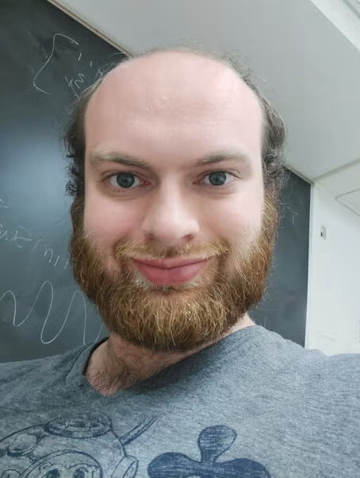

::: {.home-intro}

::: {.home-bio}

I am a PhD candidate in mathematics at the University of Illinois Urbana-Champaign, advised by [Nathan Dunfield](https://dunfield.info/). I expect to complete my PhD in May 2027. I work in geometric topology, particularly essential surfaces, essential and measured laminations, and taut foliations in 3-manifolds.

My research focuses on the interplay between laminations and surfaces. I use normal surface theory and branched surfaces to study spaces of measured laminations and the growth of essential surface counts. I am also interested in pseudo-Anosov flows and in constructing ambient metrics for which the leaves of an essential lamination are minimal.

## Research

My preprint *Growth Rate of Essential Surfaces via Measured Laminations* is available on the [arXiv](https://arxiv.org/abs/2608.08833). It relates measured lamination space to normal surface theory and gives an intrinsic geometric interpretation of the growth exponent for closed essential surface counts under the hypotheses of the paper.

My current projects include extending these counts to compact surfaces with boundary and developing a normal-coordinate model of measured lamination space using least-weight laminations. I am also investigating the relationship between hyperbolic volume and surface growth, and the existence of minimal representatives of essential laminations.

See my [research page](research.qmd) for more about my work.

In spring 2026, I was a Program Associate at SLMath for *Topological and Geometric Structures in Low Dimensions*. I also organize the UIUC Geometric Topology Seminar and mentor undergraduates through the Directed Reading Program. My [CV](cv.qmd) includes my education, talks, teaching, and service.

:::

::: {.home-photo}

{.profile-photo fig-alt="Portrait of Brevan Ellefsen"}

:::

:::

::: {.home-contact}

## Contact

Department of Mathematics  
University of Illinois Urbana-Champaign

Email: [bce2@illinois.edu](mailto:bce2@illinois.edu)

:::
